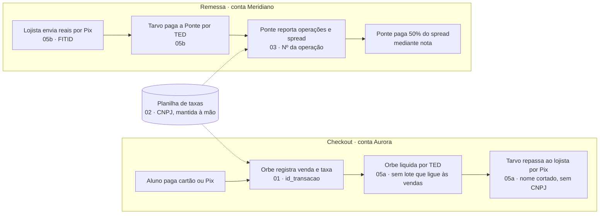
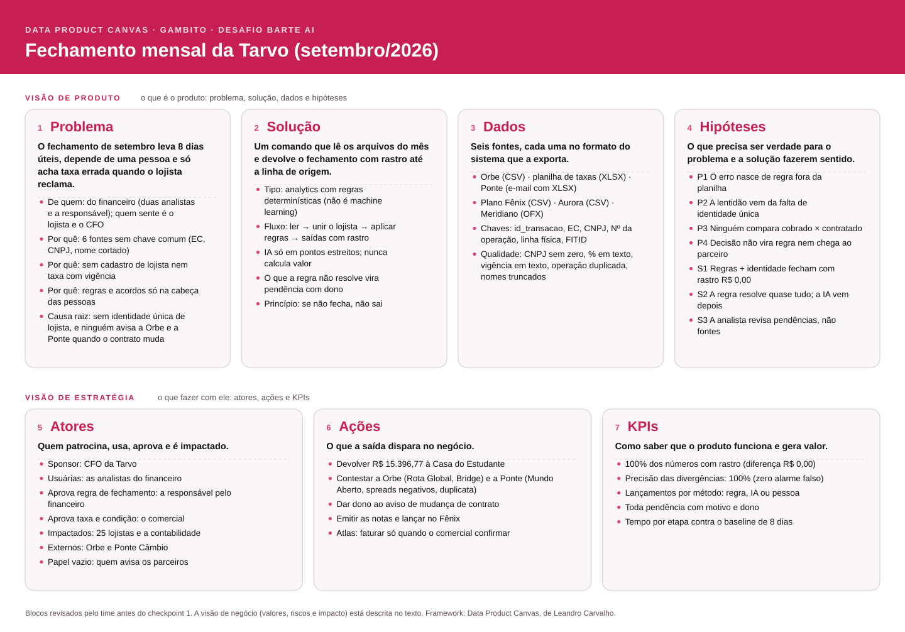

# Documentação · Gambito · fechamento mensal da Tarvo

**Desafio Barte AI · 17/10/2026 · versão das 14h (Slack lido até 13h10, com o arquivo 06)**

> **Correção RN-64 em A2 — 17/10/2026, esclarecimento do usuário nesta conversa:** a devolução é líquida. As fontes confirmam R$ 15.405,85 em 117 vendas/antecipações menos R$ 9,08 do estorno TX88446763, referente à venda isenta TX88441917 (28/09), resultando em **R$ 15.396,77 em 118 linhas**. O estorno TX88445133, da venda não isenta de agosto, fica fora da devolução e mantém a taxa original na comissão. A interpretação anterior de excluir todos os estornos estava incorreta e está substituída por este esclarecimento; não se atribui nova aprovação ao Financeiro no Slack. Os totais são referências conferidas nas fontes, nunca constantes de cálculo.


## Como este documento está organizado

| Parte | O que tem | Para quê |
|---|---|---|
| **I. Entendimento do negócio** | O case e a nossa leitura dele, bloco a bloco do **Data Product Canvas** | Dar contexto: por que a solução é do jeito que é |
| **II. Regras de negócio** | As regras que derivamos do canvas e das respostas do financeiro, as decisões do time e as premissas | Garantir que o código faz o que o negócio pede |
| **III. Requisitos** | Requisitos funcionais e não funcionais, cada um com "como verificar" | Guiar e conferir o desenvolvimento |
| **IV. Arquitetura** | O desenho técnico: módulos, fechamento parcial, estrutura de pastas e entregas | Construir do jeito combinado |
| **V. Escopo e aceite** | O que fica de fora, perguntas em aberto e checklist de aceite | Fechar a entrega sem surpresa |

**Etiquetas usadas:** `FATO` = está nos arquivos · `CONFIRMADO` = respondido pelo financeiro no Slack · `HIPÓTESE` = aposta nossa, vai para o HIPOTESES.md · `CORRIGIDO` = achávamos outra coisa e mudamos.

---

# Parte I · Entendimento do negócio

## I.1 O case em resumo

A **Tarvo Pagamentos** é uma subadquirente (fictícia) que atende escolas de idioma, agências de intercâmbio e empresas de viagem estudantil. Ela ganha dinheiro de duas formas:

- **Checkout:** o aluno paga no cartão ou no Pix. A adquirente **Orbe** processa, desconta a taxa da Tarvo (MDR e, se o lojista pedir, antecipação de 2,10%) e liquida o líquido na conta **Aurora**. A Tarvo repassa ao lojista e emite **uma nota por lojista** com a taxa do mês.
- **Remessa internacional:** o lojista manda reais para a conta **Meridiano**; a Tarvo paga a **Ponte Câmbio**, que faz o câmbio e cobra um spread. A Ponte repassa à Tarvo **50% do spread realizado**, mediante **uma nota** emitida para a Ponte.



**A tarefa:** fazer o fechamento de **setembro/2026** a partir de 6 arquivos (mais os **ajustes tardios da Orbe**, que chegaram no meio do dia como arquivo 06), do jeito que cada sistema exporta, e gerar 6 saídas: comissões por lojista, divergências de taxa, notas a emitir, lançamentos classificados no plano de contas, pendências e rastro. A solução precisa rodar de novo no mês seguinte, com arquivos novos, sem ninguém mexer no código.

**O detalhe que define o case:** "regras de negócio que não estão escritas em nenhum arquivo existem. Quem sabe é o time financeiro" (data pack). Boa parte do trabalho foi descobrir essas regras.

## I.2 Por que usamos o Data Product Canvas

O **Data Product Canvas**, de [Leandro Carvalho](https://medium.com/@leandroscarvalho/data-product-canvas-a-practical-framework-for-building-high-performance-data-products-7a1717f79f0), é um framework para planejar produtos de dados em uma única página. A ideia central é **evitar construir a solução certa para o problema errado**. Começa-se sempre pelo problema e se pergunta "por quê?" várias vezes antes de pensar em tecnologia. O autor insiste que produto de dados é um problema de negócio, não de tecnologia.

O canvas tem **10 blocos em 3 visões**:

| Visão | Blocos | Pergunta da visão |
|---|---|---|
| **Produto** | 1 Problema · 2 Solução · 3 Dados · 4 Hipóteses | O que é o produto? |
| **Estratégia** | 5 Atores · 6 Ações · 7 KPIs | O que fazer com ele e como medir? |
| **Negócio** | 8 Valores · 9 Riscos · 10 Performance/impacto | Quanto vale e o que pode dar errado? |

**Por que ele serviu para este case:**
- O case convida a pular direto para "automatizar o Excel com IA". O canvas obrigou a perguntar **por que** o fechamento demora e erra. A resposta (falta de identidade única de lojista e regras que só existem na cabeça das pessoas) mudou a solução: **antes da IA vêm o cadastro e as regras escritas**.
- O bloco de **hipóteses** virou a nossa lista de perguntas ao financeiro. Cada resposta virou uma **regra de negócio** (Parte II).
- O bloco de **ações** garantiu que a saída serve para alguém fazer alguma coisa: devolver, contestar, emitir nota, lançar.
- Deixou as três pessoas do time com a mesma visão, numa página só.



*A imagem mostra os blocos que o time revisou antes do checkpoint 1 (visões de produto e de estratégia). A visão de negócio está descrita na seção I.5.*

---

## I.3 Visão de produto

### Bloco 1 · Problema

> **Em uma linha:** o fechamento de setembro leva 8 dias úteis, depende de uma pessoa e só descobre taxa errada quando o lojista reclama.

**Qual é o problema?** O fechamento mensal é lento, manual e frágil. O único controle é uma aba na planilha onde cada analista marca "ok" e a data. `CONFIRMADO`

**Por que é um problema?**
- Erro de taxa chega ao lojista antes de chegar ao financeiro. Em setembro havia **R$ 2.995,08** de divergência de contrato e **R$ 15.396,77** líquidos a devolver por uma isenção, e ninguém tinha visto. `FATO`
- Receita de remessa só é paga "mediante nota fiscal". Nota errada ou atrasada é dinheiro parado. `CONFIRMADO`
- "Nas minhas férias, hoje ninguém fecha." O processo depende de uma pessoa. `CONFIRMADO`

**De quem é o problema?** Do **financeiro**: duas analistas (uma no checkout e na planilha de taxas, outra nos bancos e remessas) e a responsável, que confere, decide exceções e fala com o comercial, a Orbe e a Ponte. Quem **sente** o erro é o lojista; quem sente o atraso é o CFO.

**Onde vão os 8 dias** (relato do financeiro) `CONFIRMADO`:

| Etapa | Tempo | Por quê |
|---|---|---|
| Comissão de checkout | ~3 dias | Metade casando nome com EC e CNPJ à mão, metade retrabalho com planilha desatualizada |
| Remessa e Ponte | ~2 dias | Quase tudo é espera de resposta da Ponte e do comercial |
| Classificar extratos | ~2 dias | Manual, linha por linha |
| Notas e revisão | 1 dia | |

**Os porquês:**
1. **Por que demora?** Cada uma das 6 fontes é batida à mão, uma por uma.
2. **Por quê?** Não existe chave comum entre elas: a Orbe fala em **EC**, a planilha em **CNPJ**, o banco em **nome cortado**. `FATO`
3. **Por quê?** Não existe cadastro de lojista nem histórico de taxa com vigência. A planilha é ao mesmo tempo contrato, cadastro e anotação, com texto livre. `FATO`
4. **Por que erra?** As regras e os acordos não estão escritos. O caso mais caro: o comercial deu tarifa zero à Casa do Estudante, a decisão não chegou à planilha nem à Orbe, e a Orbe cobrou. `FATO` / `CONFIRMADO`
5. **Por quê?** A Tarvo cresceu 3× e o processo continuou cabendo na cabeça de alguém. "Quase tudo que vocês descobriram estava só na minha cabeça." E **ninguém tem a função de avisar a Orbe e a Ponte** quando uma condição muda. `CONFIRMADO`

**Causa raiz, em duas frases:**
- O fechamento é **lento** porque não existe uma identidade única de lojista e as regras não estão escritas: as analistas casam tudo à mão e refazem o que a planilha desatualizada errou.
- **Erra** porque as condições que o comercial combina ficam na cabeça de quem negociou, e ninguém é dono de avisar a Orbe e a Ponte quando um contrato muda.

**O que mudou no nosso entendimento:**
- `CORRIGIDO` Achávamos que a comissão era o `valor_taxa` que a Orbe cobra. Não é: é o valor bruto × a taxa **contratada**. Se fosse o cobrado, o erro da Orbe ficaria embutido na nota.
- `CORRIGIDO` Achávamos que a Casa do Estudante era uma divergência a cobrar da Orbe. Não é: foi uma concessão do comercial fora do contrato, então a Orbe cobrou certo e a devolução sai do bolso da Tarvo.

### Bloco 2 · Solução

> **Em uma linha:** um comando que lê os arquivos do mês como chegam e devolve o fechamento com rastro até a linha de origem, mais a lista do que precisa de decisão humana.

**Que tipo de solução?** **Analytics com regras determinísticas.** Não é machine learning, porque:
- não há histórico rotulado para treinar;
- o resultado precisa ser **o mesmo toda vez** e **auditável**, já que vira nota fiscal e contestação;
- as respostas do financeiro são regras explícitas ("a taxa é a contratada", "arredondamento comum por linha"), não padrões a aprender.

**O que é a solução?** Um pipeline em camadas:

| Camada | O que faz |
|---|---|
| 1. Leitura | Lê os 6 arquivos como vêm (encoding, cabeçalho deslocado, e-mail com anexo, OFX), guardando de onde veio cada linha |
| 2. Normalização | Dinheiro em decimal, datas, CNPJ com 14 dígitos, nomes sem acento, faixa da transação |
| 3. Identidade | Cadastro de lojista: EC ↔ CNPJ ↔ nomes do banco |
| 4. Regras | Comissão, divergência, notas, classificação contábil, a partir de um **arquivo de regras** legível |
| 5. Pendências | O que a regra não resolve vira pendência com motivo, próximo passo e quem decide |
| 6. Validação e saída | Confere que todo número fecha com as linhas de origem; grava os 6 arquivos |

A **IA entra só em pontos estreitos**: sugerir a conta de um histórico bancário novo, sugerir um vínculo de nome, explicar uma pendência em português. Ela **nunca calcula valor nem aprova regra**; tudo o que sugere vira pendência para alguém revisar.

**O que se espera da solução?** As 6 saídas no formato do enunciado. O princípio que guia tudo: **todo número aponta para a origem; se não fecha, não sai**.

### Bloco 3 · Dados

> **Em uma linha:** seis fontes, cada uma no formato do sistema que a exporta, sem chave comum entre elas.

| Fonte | Formato e acesso | Uma linha é | Chave | Qualidade e armadilhas |
|---|---|---|---|---|
| **01 Orbe** | CSV `;`, vírgula decimal (download do portal) | Lançamento: venda, estorno, antecipação, reversão | `id_transacao`; lojista pelo **EC** | Aritmética íntegra; o mesmo EC com grafias diferentes `FATO` |
| **02 Planilha de taxas** | XLSX mantido à mão, 2 abas | Contrato do lojista com vigência | **CNPJ** | Cabeçalho na linha 5; % ora fração, ora texto; CNPJ sem zero à esquerda; vigência em texto; 3 lojistas sem EC; aba "ANTIGO 2025" não vale para taxa `FATO` |
| **03 Ponte** | E-mail `.eml` com XLSX anexo | Operação de câmbio | **Nº da operação** | Uma operação duplicada; 4 spreads negativos; total do relatório inclui a duplicata `FATO` |
| **04 Plano de contas Fênix** | CSV latin-1 (exportado do ERP) | Conta contábil | Código da conta | Só contas analíticas aceitam lançamento `FATO` |
| **05a Aurora** | CSV de banco com cabeçalho | Movimento da conta principal | **Linha física** (L9…) | Nome do lojista cortado; saldo negativo é a conta garantida `FATO` / `CONFIRMADO` |
| **05b Meridiano** | OFX em cp1252 | Movimento da conta de remessas | **FITID** | Acentos quebrados; transferências entre contas próprias `FATO` |
| **06 Ajustes tardios da Orbe** | CSV no **mesmo formato do 01**; chegou às 13h10 do dia do fechamento | Lançamentos que ficaram fora do relatório (em setembro: 10 estornos, 3 reversões de antecipação e 1 venda) | `id_transacao`; o `id_referencia` aponta para linhas do 01 | Pode chegar depois do relatório; precisa entrar no fechamento `FATO` / `CONFIRMADO` |

- **Acesso e disponibilidade:** os 6 arquivos vêm no data pack. Todo mês a estrutura é a mesma, mas, na prática, arquivo chega atrasado, a Orbe manda ajuste depois e já houve parceiro mudando o layout sem avisar. A solução precisa **avisar, não quebrar calada**. `CONFIRMADO` Isso aconteceu no próprio dia: às 13h10 a Orbe mandou 14 ajustes de setembro (arquivo 06), e o fechamento entregue precisa considerá-los. `CONFIRMADO`
- **Transformação:** leitura "como vem", normalização e ligação pelo cadastro de lojista (camadas 1 a 3 da solução).
- **Saídas:** 6 CSVs com `;` em `saida/`.
- **Teste e validação:** sem treino de modelo. A validação é o **rastro** (cada número soma as linhas de origem), os **números de referência** da análise exploratória (só para conferir, nunca como critério) e um **mês simulado** para provar que nada está fixo em setembro.

### Bloco 4 · Hipóteses

> **Em uma linha:** o que precisa ser verdade para o problema e a solução fazerem sentido, e o que fazemos com cada resposta.

As hipóteses **P** explicam por que o fechamento falha; as **S** dizem o que a solução precisa provar.

| # | Hipótese | Resposta esperada | Evidência | O que fazemos com a resposta |
|---|---|---|---|---|
| P1 | O fechamento erra porque regras de negócio vivem fora da planilha | Sim | Casa do Estudante: tarifa zero combinada e nunca registrada (R$ 15.396,77) | Toda regra vai para um arquivo de regras com fonte e aprovador |
| P2 | É lento porque não há identidade única de lojista | Sim | EC, CNPJ e nome cortado; 3 vínculos só se resolveram perguntando | Cadastro de lojista antes de qualquer cálculo |
| P3 | Erro de taxa só aparece por reclamação porque ninguém compara cobrado × contratado | Sim | 115 divergências (R$ 2.995,08) que ninguém tinha visto | Divergência transação por transação, sem alarme falso |
| P4 | Decisão comercial não vira regra e não chega aos parceiros | Sim | "Ninguém tem essa função hoje"; Bridge avisada dias depois; Casa e Mundo Aberto nunca avisadas | Registrar quem aprova; recomendar um dono para o aviso |
| S1 | Regras escritas + identidade de lojista fecham o mês com rastro | Diferença R$ 0,00 | — | Se não fechar, a saída não é gravada |
| S2 | Em setembro a regra resolve quase tudo; a IA ganha valor depois | Quase 100% por regra | Na exploração, todos os Pix casaram por regra | Medir lançamentos por método (regra, IA, pessoa) |
| S3 | Com a solução, a analista revisa pendências em vez de bater 6 fontes | Poucas pendências, todas nomeadas | As exceções do mês são poucas: Casa, Atlas, Pix sem pagador, R$ 300 mil em trânsito, duplicata, spreads negativos | Cada pendência com motivo, valor, próximo passo e dono |

As hipóteses viraram as **perguntas que fizemos ao financeiro**. As respostas viraram as regras da Parte II (ver I.6).

---

## I.4 Visão de estratégia

### Bloco 5 · Atores

> **Em uma linha:** o produto serve o financeiro, depende do comercial para as condições e conversa com dois parceiros externos.

| Pergunta | Resposta |
|---|---|
| Quem é o sponsor? | O CFO da Tarvo |
| Quem é o cliente final? | O time financeiro, que fecha o mês |
| Quem usa? | As analistas do financeiro |
| Quem consome a saída? | A responsável pelo financeiro (decide pendências e contestações), a contabilidade (lança no Fênix) e o fiscal (emite notas) |
| Quem aprova? | Taxa e condição comercial: **o comercial**. Regra de fechamento e liberação: **o financeiro** `CONFIRMADO` |
| Quem é impactado? | Os 25 lojistas (ressarcimento, notas) e a contabilidade |
| Quem é externo? | Orbe (contestação de taxa) e Ponte Câmbio (contestação de spread, ajustes no mês seguinte) |
| Papel que falta | **Ninguém é dono de avisar a Orbe e a Ponte quando uma condição muda.** É um papel a criar |

### Bloco 6 · Ações

> **Em uma linha:** cada saída precisa disparar uma ação concreta, com dono.

| Ação | Disparada por | Quem decide |
|---|---|---|
| Ressarcir a Casa do Estudante (R$ 15.396,77) e registrar a tarifa zero na planilha e na Orbe até dezembro | Pendência de devolução | Financeiro com o comercial |
| Contestar a Orbe: Rota Global e Bridge | Divergências de checkout | Financeiro |
| Contestar a Ponte: Mundo Aberto, spreads negativos e operação duplicada | Divergências e pendências de remessa | Financeiro |
| Dar um dono ao aviso de mudança de contrato para a Orbe e a Ponte | Achado de processo | Financeiro e comercial |
| Confirmar a taxa da Atlas e faturar setembro junto com o mês seguinte | Pendência de lojista sem contrato | Comercial |
| Escrever regra e limite para o repasse antecipado ao lojista | Achado de processo (hoje "sem limite" e sem registro) | Financeiro |
| Identificar o Pix de R$ 7.350 sem pagador e a devolução de R$ 12.400 | Pendências de caixa | Financeiro |
| Emitir as notas e lançar no Fênix | Notas a emitir e lançamentos classificados | Financeiro e contabilidade |

**Como gera valor:** o dinheiro cobrado errado volta ao lojista **antes** da reclamação, a contestação sai com as operações anexadas e a nota da Ponte sai certa, liberando o repasse.

### Bloco 7 · KPIs

> **Em uma linha:** medir se o produto está certo (qualidade) e se as ações geram resultado (efetividade).

**Qualidade do produto**

| KPI | Meta | Por quê |
|---|---|---|
| Rastro: números que fecham com as linhas de origem | **100%**, diferença R$ 0,00 | Prova S1; é o que a banca confere |
| **Precisão** das divergências (das que apontamos, quantas são reais) | **100%** (zero alarme falso) | Alarme falso conta contra; prova P3 |
| **Cobertura** das divergências (das reais, quantas apontamos; em inglês, *recall*) | 100% | Não deixar passar diferença de verdade |
| Linhas de entrada com destino | 100% | Nada some no caminho |
| Lançamentos por método (regra, IA, pessoa) | Quase tudo por regra | Prova S2 |

**Efetividade das ações**

| KPI | Como medir |
|---|---|
| R$ achados no fechamento, e não por reclamação | Soma das divergências e devoluções do mês |
| Tempo por etapa contra o baseline (3 + 2 + 2 + 1 dias) | Medir de novo no mês seguinte; não prometemos número de dias antes de medir |
| Regras escritas com dono | Quantas das decisões "que estavam só na cabeça" estão no arquivo de regras |
| Pendências resolvidas por mês | Contagem por tipo e por quem decide |

**Quanta incerteza aceitamos?** Nos **valores, nenhuma**: a solução é determinística e o rastro fecha em R$ 0,00. A incerteza fica só nas **sugestões da IA**, que nunca viram número sem revisão humana.

---

## I.5 Visão de negócio

### Bloco 8 · Valores

> **Em uma linha:** em um mês, R$ 18,4 mil cobrados errado e 8 dias úteis de três pessoas.

| Pergunta | Resposta |
|---|---|
| Qual o tamanho do problema? | **R$ 2.995,08** de divergência de contrato (Rota Global R$ 1.546,28; Bridge R$ 29,95; Mundo Aberto R$ 1.418,85) e **R$ 15.396,77** a devolver à Casa do Estudante. Cerca de **7% da comissão do mês** |
| Qual o baseline? | 8 dias úteis × 3 pessoas por mês; erro de taxa descoberto por reclamação |
| O que mais está em jogo? | Comissão de checkout (~R$ 204 mil, já com os ajustes tardios) e de remessa (~R$ 39,5 mil, paga só com nota); Atlas transacionando sem contrato (R$ 262 mil brutos) |
| Qual o ganho esperado? | Divergência achada no fechamento, nota da Ponte certa e menos dias de trabalho manual. O número de dias só depois de medir |

### Bloco 9 · Riscos

| Risco | O que pode bloquear |
|---|---|
| Casar lojista por semelhança de nome e aceitar o errado (há duas "Horizonte") | Comissão no lojista errado |
| Usar o `valor_taxa` da Orbe como comissão | Nota com o erro da Orbe embutido |
| Alarme falso por regra mal entendida (estorno, vigência, isenção) | Perda de confiança no produto |
| A IA "decidir" uma regra | Número sem auditoria |
| Arquivo atrasado ou com layout diferente | Fechamento quebrando calado |
| Repasse antecipado sem regra nem limite | Risco de caixa que o fechamento não enxerga (achado de processo) |
| Regra que muda depois da entrega (resposta nova do financeiro) | Código desatualizado, se a regra estiver no código e não no arquivo de regras |

### Bloco 10 · Performance e impacto

| Pergunta | Resposta |
|---|---|
| Qual o impacto para o negócio? | O mês seguinte fecha com os arquivos novos, sem retrabalho; a divergência aparece antes de o lojista perceber; nenhuma receita de remessa fica sem nota; a regra deixa de depender de uma pessoa |
| Como medir? | Os KPIs do bloco 7, mês a mês |
| Onde se vê? | Nas saídas (`saida/*.csv`), no rastro e no resumo do fechamento |

---

## I.6 Do canvas às regras de negócio

O caminho foi: **hipótese → pergunta ao financeiro → resposta → regra escrita**. Quando o financeiro disse "o critério é de vocês", a resposta virou **decisão do time** (com o motivo no HIPOTESES.md).

| Hipótese | O que perguntamos | Regras que nasceram (Parte II) |
|---|---|---|
| P1 · regras fora da planilha | Comissão pelo cobrado ou pelo contratado? Casa tem condição especial? | RN-08, RN-15, RN-16, RN-26, RN-64 |
| P2 · sem identidade única | De quem são os ECs sem cadastro? A Atlas é cliente? | RN-03 a RN-07 |
| P3 · ninguém compara cobrado × contratado | O que é divergência? Pelo valor cheio? E o estorno? | RN-20 a RN-30 |
| P4 · decisão não chega ao parceiro | Quem avisa a Orbe e a Ponte? Quem aprova regra? | RN-01, RN-60, RN-61 |
| S1 · rastro fecha | Como arredondar? Por linha ou no total? | RN-09, RN-31 |
| S3 · analista revisa pendências | Como agrupar pendências? O que fazer quando falta um arquivo? | RN-58, RN-59, RN-62 |

---

# Parte II · Regras de negócio

Regras derivadas do canvas (seção I.6) e das respostas do financeiro. **Como usar:** cada item tem um "Como verificar"; quem implementa marca `[x]`, quem audita roda a verificação e confirma. Se o Slack mudar uma regra, muda aqui **e** no arquivo de regras, nunca só no código.

**Fontes:** `SLACK dd hh:mm` = resposta do financeiro no #duvidas-hackathon-ai (16 = noite de 16/10; 17 = manhã de 17/10). `ORG` = organização. `CASE` = enunciado ou data pack. `TIME` = decisão nossa.

## II.1 Regras de negócio

### II.1.1 Princípio que decide quem deve

| ✓ | ID | Regra | Fonte | Como verificar |
|---|---|---|---|---|
| [ ] | RN-01 | **O que decide se cobramos da contraparte é o contrato, não o aviso.** Se a Orbe ou a Ponte cobrou diferente de uma condição **contratada** (mesmo que ela não tenha sido avisada), é **divergência**: contesta-se com a contraparte e o lojista é ressarcido. Se a condição foi uma **concessão do comercial fora do contrato** (Casa do Estudante), a contraparte cobrou certo e a devolução sai **do bolso da Tarvo**. | SLACK 17 11:37 | Bridge e Mundo Aberto em divergências; Casa fora da cobrança da Orbe |
| [ ] | RN-02 | A nota só documenta a taxa já descontada pela Orbe no repasse. Quando a Orbe cobra a mais, o lojista **já recebeu a menos** e precisa ser ressarcido. | SLACK 17 10:44 | — (contexto para os textos de pendência) |

### II.1.2 Identidade do lojista

| ✓ | ID | Regra | Fonte | Como verificar |
|---|---|---|---|---|
| [ ] | RN-03 | CNPJ sempre com 14 dígitos, sem máscara (completar com zeros à esquerda). | CASE | Nenhum CNPJ na saída com menos de 14 dígitos ou com ponto/barra |
| [ ] | RN-04 | A chave do lojista é o **CNPJ**. A Orbe chega ao CNPJ pelo **EC** da planilha. | CASE | Toda linha de `comissoes_por_lojista` tem CNPJ; nenhum lojista duplicado por grafia |
| [ ] | RN-05 | ECs que faltam na planilha: 1043300981 = Novo Horizonte Intercâmbio; 1043396662 = Horizonte Viagens (empresas **diferentes**); 1038867654 = Kiwi Experience. Ficam no arquivo de regras. | SLACK 16 20:24 | Os 3 com o CNPJ certo; buscar esses números no código = 0 |
| [ ] | RN-06 | **Proibido casar por semelhança de nome.** Nome do banco só liga a um lojista quando é inequívoco; senão, vira pendência. | TIME | As duas "Horizonte" saem separadas; teste com nome ambíguo gera pendência |
| [ ] | RN-07 | A aba "ANTIGO 2025" **não vale para taxa**, mas pode ser usada para **identificar**. A Atlas é a mesma empresa: CNPJ 39566044000119. | SLACK 16 20:24 e 17 11:41 | Atlas na saída com CNPJ; nenhuma taxa vem dessa aba |

### II.1.3 Comissão de checkout (Orbe)

| ✓ | ID | Regra | Fonte | Como verificar |
|---|---|---|---|---|
| [ ] | RN-08 | Comissão = **valor bruto × taxa contratada**, linha a linha. O `valor_taxa` da Orbe **nunca** é a comissão. A comissão é a taxa inteira, sem descontar custo da Orbe. | SLACK 16 20:05 e 22:34 | Linha da Rota após 12/09 usa a taxa da planilha |
| [ ] | RN-09 | **Arredondamento comum** ao centavo (meio centavo para cima; no negativo, −0,005 vira −0,01), **por linha**, depois soma. Não truncar. | SLACK 16 21:13 | Exemplo: 608,88 × 2,69% = 16,3787 → **16,38** (a Orbe, que trunca, informa 16,37) |
| [ ] | RN-10 | Taxa pela **faixa**: débito, crédito à vista, 2 a 6x, 7 a 12x, Pix, antecipação. No estorno, a faixa (modalidade e parcelas) sai **da própria linha do estorno**. | CASE / SLACK 17 11:38 | Venda 7x usa a coluna 7–12x |
| [ ] | RN-11 | **Acima de 12x vira pendência**, fora da comissão. A Tarvo não vende nessa faixa. | SLACK 17 11:01 | Linha de teste com 13x → pendência |
| [ ] | RN-12 | **Vigência pela data da venda.** A planilha traz "até dd/mm" e "a partir de dd/mm". Bridge: **aditivo assinado**, 2,19% a partir de 15/09. | CASE / SLACK 17 11:37 | Bridge: venda de 14/09 a 2,59%; de 15/09 a 2,19% |
| [ ] | RN-13 | **Estorno** abate no **mês do estorno** (inclusive venda de agosto), pela taxa da **data da venda original**. Agosto não é reaberto. | SLACK 16 20:06 / 17 11:38 | TX88444848 (Oxford Prep) abate em setembro pela taxa de 22/08 |
| [ ] | RN-14 | **Antecipação** (2,10%) entra na comissão e na mesma nota do lojista. A **reversão** anula só a antecipação que ela referencia. | SLACK 16 20:47 | AN88445114 anula exatamente a AN88444915 |
| [ ] | RN-15 | **Casa do Estudante:** tarifa **zero** no checkout (MDR e antecipação) para **vendas a partir de 01/09** até 31/12. Remessa normal. Fica no arquivo de regras. | SLACK 16 20:49 / 17 11:41 | Comissão de checkout da Casa em setembro só tem o estorno de agosto |
| [ ] | RN-16 | Estorno de venda da Casa **anterior** a 01/09 usa a taxa da venda original. | SLACK 17 09:44 e 11:41 | TX88445133 abate pela taxa de agosto; Casa fecha em −R$ 5,50 |
| [ ] | RN-17 | **Lojista sem contrato** (Atlas, EC 1076801732): **não fatura**, vira pendência para o comercial. Aparecer com zero ou ficar fora do arquivo de comissões é escolha nossa (ver D-07); **faturar é proibido**. | SLACK 16 20:24 / 17 11:38 e 11:41 | Atlas sem nota; pendência com as 57 linhas |
| [ ] | RN-18 | Atlas: quando o comercial confirmar, a taxa vale **desde 10/09** e o mês seguinte fatura as linhas de setembro junto. | SLACK 17 09:47 | (Extra) linhas guardadas num formato que o próximo fechamento lê |
| [ ] | RN-19 | **O repasse ao lojista não para** sem contrato; só o faturamento da taxa fica suspenso. | SLACK 17 11:03 | Pix enviado à Atlas classificado como repasse normal |
| [ ] | RN-65 | **Ajustes tardios da Orbe:** arquivos no **mesmo formato do 01** que chegam depois do relatório (ex.: `06_orbe_ajustes_tardios_set2026.csv`) **entram no fechamento** da competência do `data_movimento`, com as mesmas regras (RN-08 a RN-19, RN-64). O `id_referencia` pode apontar para linhas do relatório principal (estorno → venda; reversão → antecipação). O mesmo `id_transacao` em dois arquivos conta uma vez e vira pendência; referência não encontrada vira pendência. É o caso real descrito pelo financeiro ("a Orbe manda ajuste depois do relatório"), não um erro. | ORG 17 13:10 / SLACK 17 12:31 | Rodar com 01 + 06: as 14 linhas entram, o rastro delas aponta para o arquivo 06 e a comissão de checkout muda em 7 lojistas |

### II.1.4 Divergências de taxa

| ✓ | ID | Regra | Fonte | Como verificar |
|---|---|---|---|---|
| [ ] | RN-20 | Divergência = **taxa aplicada ≠ contratada** (comparar **taxas**). Valor = bruto × (aplicada − contratada), com o arredondamento da RN-09. Centavo de truncamento **não** é divergência. | SLACK 16 21:13 | Nenhuma divergência com taxa aplicada = contratada |
| [ ] | RN-21 | **Uma linha por transação.** O **estorno** de uma venda que veio com taxa errada **também entra**, com valor **negativo**. | SLACK 17 11:38 | Estornos da Rota com valor negativo no arquivo |
| [ ] | RN-22 | Na cobrança, venda e estorno se anulam: cobra-se da Orbe a **diferença líquida**. | SLACK 17 09:44 | Pendência da Rota com o líquido (vendas − estornos) |
| [ ] | RN-23 | Taxa **menor** que a contratada também é divergência; decisão caso a caso. | SLACK 17 09:44 | Valor negativo aceito |
| [ ] | RN-24 | **Rota Global:** contrato não mudou; os +0,50 p.p. desde 12/09 são divergência. | SLACK 16 20:49 | 87 linhas da Rota |
| [ ] | RN-25 | **Bridge:** cobrou 2,59% em 5 vendas de 15 a 18/09 com aditivo de 2,19% assinado. É **divergência**, contestada com a Orbe. | SLACK 17 11:37 | 5 linhas da Bridge em divergências e na cobrança da Orbe |
| [ ] | RN-26 | **Casa do Estudante não é divergência de contrato.** Vira **devolução ao lojista**, paga pela Tarvo: pendência com o total e o detalhe por transação, **separada das divergências de contrato** e **fora da cobrança da Orbe**. Pôr as 118 linhas também em divergências, marcadas como isenção, é opcional. | SLACK 17 09:44, 10:58 e 11:49 | Total cobrável da Orbe sem a Casa |
| [ ] | RN-64 | **Valor da devolução ao lojista = o que saiu do bolso dele:** o que a Orbe **descontou de fato** (`valor_taxa`) menos a comissão contratada. **Linhas elegíveis da Casa:** vendas e antecipações com **data da venda de 01/09 a 31/12**; estornos de vendas isentas também entram, com valor_taxa assinado negativo, conforme vínculo e vigência da venda original. O movimento no período, sozinho, não torna a venda isenta. O estorno da venda de agosto continua abatendo a comissão pela taxa de agosto (RN-16). Como a contratada é zero, soma-se o `valor_taxa` assinado das linhas elegíveis: R$ 15.405,85 de vendas/antecipações menos R$ 9,08 do estorno elegível. O `divergencias_taxa.csv` mantém a fórmula da RN-20; a diferença é o centavo de truncamento da Orbe. **R$ 15.396,77 é referência de conferência, nunca constante no código.** | SLACK 17 12:50 (base); esclarecimento do usuário nesta conversa em 17/10/2026 (recorte) | Pendência da Casa = soma do `valor_taxa` das linhas elegíveis (setembro: R$ 15.396,77) |
| [ ] | RN-27 | Lojista sem contrato (Atlas) **não é divergência**; é pendência. | CASE / TIME | Nenhuma linha da Atlas em divergências |
| [ ] | RN-28 | Divergência de **remessa** = spread % aplicado − contratado, pelo **valor cheio**: Δ% × PTAX × valor em moeda estrangeira. **Mundo Aberto** (1,20% registrado desde julho) é divergência, contestada com a Ponte. | SLACK 16 20:48 e 20:58 / 17 11:37 | 23 linhas da Mundo Aberto pelo valor cheio |
| [ ] | RN-29 | **Spread negativo não é divergência** (o lojista não pagou a mais). Se aparecer na lista, marcado como outra natureza. | SLACK 17 09:44 | As 4 operações negativas fora de divergências (ou com natureza própria) |
| [ ] | RN-30 | Tolerância de spread **≤ 0,01 p.p.** = arredondamento da Ponte, não divergência. Número no arquivo de regras. | TIME (SLACK 16 20:58 aceita critério escrito) | Lojistas a 1,5% com 1,4984% a 1,5015% não aparecem |

### II.1.5 Comissão de remessa (Ponte)

| ✓ | ID | Regra | Fonte | Como verificar |
|---|---|---|---|---|
| [ ] | RN-31 | Comissão = **50% do Spread R$ realizado**, por operação, com o arredondamento da RN-09. | SLACK 16 20:48 e 21:13 | 50% de 262,01 = **131,01** |
| [ ] | RN-32 | Spread em branco ou "padrão" = **1,5%** sobre a PTAX. | SLACK 16 20:48 | Lojista sem spread compara com 1,5% |
| [ ] | RN-33 | Vale a **data de contratação**. | SLACK 16 20:48 | PC-0926-0002 (liquidada em 01/10) entra em setembro |
| [ ] | RN-34 | **Operação repetida conta uma vez** (o número é único) e entra na lista para a Ponte corrigir o relatório. | SLACK 16 20:48 / 22:34 | PC-0926-0162 uma vez; pendência criada |
| [ ] | RN-35 | **Spread negativo** (trava D-1 vencida): fora da comissão e da nota. Pendência de contestação com **os dois valores, identificados**: (a) o spread negativo do relatório (o que aconteceu) e (b) a diferença até o spread do contrato (o que se pede à Ponte). | SLACK 16 20:48 / 17 11:37 · formato em D-11 | Ex.: PC-0926-0210 com −R$ 687,52 (relatório) e −R$ 1.351,87 (até o contrato) |
| [ ] | RN-36 | **Mundo Aberto:** nota pelo **realizado** (nossa metade do excesso entra); a diferença fica como pendência de contestação. | SLACK 16 21:45 | Comissão pelo realizado + pendência |
| [ ] | RN-37 | **Ajuste da Ponte** (outubro em diante): chega como **linha nova**, com Nº de operação próprio, **Spread R$ negativo** e observação **"AJUSTE REF PC-…"**. Entra **no mês em que aparece**, **abate a nossa participação** dentro da nota única da Ponte, e o rastro aponta para a **operação original**. Sem nota complementar. **Não confundir** com spread negativo de trava (RN-35) nem com duplicata (RN-34). | SLACK 17 11:33 | Teste com linha "AJUSTE REF" → abate a comissão do mês |
| [ ] | RN-38 | "Aprovado c/ ressalva" **não muda nada**. | SLACK 16 20:48 | Operações com ressalva entram |
| [ ] | RN-39 | Não supor desconto da Ponte no repasse. Conferir o TED quando cair é pendência de acompanhamento. | SLACK 16 22:33 | Nenhum repasse estimado na saída |
| [ ] | RN-40 | CNPJ da Ponte fora da planilha: calcula a nossa metade e abre pendência de cadastro para o comercial. | SLACK 17 09:45 (premissa aceita) | Teste com CNPJ novo |
| [ ] | RN-41 | Contestações: considerar **dentro do prazo**. A pendência traz valor e operações, porque é o que vai para a contraparte. | SLACK 16 22:34 | Pendências de contestação com operações listadas |

### II.1.6 Notas fiscais

| ✓ | ID | Regra | Fonte | Como verificar |
|---|---|---|---|---|
| [ ] | RN-42 | **Checkout:** uma nota por lojista por mês, pela comissão da taxa contratada. | SLACK 16 20:47 | Uma linha por CNPJ com comissão positiva |
| [ ] | RN-43 | Saldo **zero ou negativo não emite nota**, **não** passa para o mês seguinte e vira pendência. Vale também para a nota da Ponte depois de um ajuste. | SLACK 16 20:47 / 17 11:33 | Casa (−R$ 5,50) sem nota e com pendência |
| [ ] | RN-44 | **Remessa:** **uma nota só**, tomadora **Ponte Câmbio** (CNPJ 75374179000146), pelo total da participação. Sem nota por lojista; sem nota complementar. | SLACK 16 20:47 / 17 11:33 | Uma única linha de remessa |
| [ ] | RN-45 | Discriminação simples: serviço + competência. | SLACK 16 20:47 | Texto com a competência do mês |

### II.1.7 Extratos e plano de contas

| ✓ | ID | Regra | Fonte | Como verificar |
|---|---|---|---|---|
| [ ] | RN-46 | `conta_codigo` = **contrapartida** do movimento. Se o valor já estava registrado, o pagamento baixa a conta onde ele estava. | SLACK 16 21:14 | — |
| [ ] | RN-47 | **Folha e impostos são sempre provisionados**; o pagamento no mês seguinte baixa o passivo (2.1.04.x / 2.1.03.x). | SLACK 16 20:49 / 17 09:48 | Salários, INSS, FGTS, ISS e DARFs em passivo |
| [ ] | RN-48 | **A provisão do mês corrente NÃO é feita pela solução** (é da contabilidade). O fechamento só classifica o que passou nos extratos. | SLACK 17 11:49 | Nenhum lançamento de provisão de setembro na saída |
| [ ] | RN-49 | Repasse da Ponte de 04/09 (spread de agosto) baixa a comissão a receber (1.1.03.002). | SLACK 16 20:49 | — |
| [ ] | RN-50 | Tarifas, aluguel, cloud, assinaturas e serviços → **despesa do mês**. | SLACK 16 21:14 | — |
| [ ] | RN-51 | Só contas que **aceitam lançamento** no plano Fênix. Conta por conta o financeiro não valida; vale o critério da RN-46. | CASE / SLACK 17 11:01 | Toda conta da saída existe e é analítica |
| [ ] | RN-52 | Pix de **R$ 7.350 sem pagador**: não é receita → 1.1.09.002, com pendência. | SLACK 16 20:49 | — |
| [ ] | RN-53 | **Devolução de Pix de R$ 12.400** (Mundo Aberto): repasse que voltou, ainda devido ao lojista; motivo desconhecido → pendência. Conta: ver D-06. | SLACK 16 20:49 / 17 09:48 | — |
| [ ] | RN-54 | **TED de R$ 300 mil** de 30/09: transferência entre contas próprias (1.1.09.001), em trânsito; cai no Meridiano em 01/10. | SLACK 16 20:49 | — |
| [ ] | RN-55 | **Pix de R$ 18.240 da Ponte Aérea**: adiantamento de remessa que sai em outubro → 2.1.02.001. A Ponte Aérea é lojista, sem relação com a Ponte Câmbio. | SLACK 17 09:44 | — |
| [ ] | RN-56 | **Não conciliar a Orbe parcela a parcela** contra o banco; só classificar os créditos. Saldo negativo do Aurora = conta garantida. | SLACK 16 22:34 | Nenhuma pendência "Orbe não bate com banco" |
| [ ] | RN-57 | Referência: Aurora = **linha física** do arquivo; Meridiano = **FITID**. | CASE / D-04 | `ref_origem` do 1º lançamento do Aurora = L9 |

### II.1.8 Pendências, bloqueios e aprovação

| ✓ | ID | Regra | Fonte | Como verificar |
|---|---|---|---|---|
| [ ] | RN-58 | Toda pendência tem **tipo, ref_origem, valor, motivo, próximo passo e quem decide** (o próximo passo vai numa coluna extra `proximo_passo`; o formato oficial permite colunas extras). Pendência de **acompanhamento** (ex.: "conferir o TED quando cair") **não é alarme falso**, desde que tenha motivo e próximo passo. | ORG 17 11:27 | Nenhuma célula vazia em `pendencias.csv` |
| [ ] | RN-59 | Pendência **por contraparte e por lojista**, com o detalhe das transações. `ref_origem` pode ter várias origens separadas por `\|` ou uma linha por origem. | SLACK 17 11:01 / ORG 17 11:27 | Dá para achar cada origem a partir da pendência |
| [ ] | RN-60 | **Quem decide** (texto livre, coerente): taxa, condição comercial, cadastro e contrato → **comercial decide antes**; regra de fechamento, divergência, contestação, caixa e liberação → **financeiro**. | SLACK 17 09:49, 11:01 e 12:31 / ORG 17 11:27 | Atlas e cadastro com "Comercial"; o resto com "Financeiro" |
| [ ] | RN-61 | Toda regra registra **quem aprovou e quando**. | SLACK 17 09:49 | Campo de fonte/aprovação em cada regra |
| [ ] | RN-62 | **Fonte faltando ou atrasada, ajuste tardio ou layout mudado:** a solução **avisa** (nunca quebra calada), **fecha o que não depende** daquilo, marca o que é **provisório** e deixa claro o que está **bloqueado e por quê**. Quem libera é o financeiro; se for taxa ou cadastro, o comercial decide antes. | SLACK 17 12:31 | Teste sem o arquivo da Ponte: checkout e extratos saem; remessa marcada como bloqueada |
| [ ] | RN-63 | **Alerta de antecipação** para o financeiro e o comercial. A antecipação é sobre a agenda inteira do lojista, então comparar com as vendas do mês acende lojista demais. A preocupação é **lojista novo, sem histórico, antecipando alto**. O alerta **não muda nenhum número**. Critério: ver D-03. | SLACK 17 09:44, 11:37 e 11:49 | (Extra) só a Atlas acende em setembro |

---

## II.2 Decisões do time e premissas (vão para o HIPOTESES.md)

### II.2.1 Decisões nossas

| ✓ | ID | Decisão | Motivo | Como desfazer |
|---|---|---|---|---|
| [ ] | D-02 | Tolerância de spread de **0,01 p.p.** | A Ponte oscila ±0,002 p.p.; a Mundo Aberto difere 0,30 p.p. (30×) | Mudar o número no arquivo de regras |
| [ ] | D-03 | Alerta de antecipação só para lojista **sem contrato ou sem histórico**, calculado pelo **pico** (o risco existiu quando o dinheiro foi adiantado), **citando as reversões** no texto | O financeiro disse que o critério é nosso e que a preocupação é lojista novo; achou a proposta do pico "razoável" (12:50) | Mudar o critério no arquivo de regras |
| [ ] | D-04 | Referência do Aurora = **linha física** (1º lançamento = L9) | O enunciado mostra L10, L11 só como exemplo | Mudar uma linha no leitor |
| [ ] | D-05 | Divergência da Mundo Aberto pelo **Spread %** (R$ 1.418,85), não pelo Spread R$ (R$ 1.418,88) | O % é o que se compara com o contrato; o financeiro pediu um critério escrito | Trocar o critério no motor |
| [ ] | D-06 | Devolução de R$ 12.400 em **2.1.01.001** | O repasse volta a ser devido ao lojista; o financeiro aceitou 2.1.01.001 ou 2.1.01.002 com motivo | Mudar a conta no arquivo de regras |
| [ ] | D-07 | Atlas **fora** do `comissoes_por_lojista.csv`, com pendência para o comercial (valor que a Orbe cobrou e as 57 linhas no rastro) e **identidade preservada** (CNPJ da aba antiga) | O financeiro aceita zerada ou fora; uma linha com zero parece cálculo concluído | Incluir com valor zero |
| [ ] | D-09 | Casa **só na pendência** (total + detalhe), sem as 118 linhas em divergências | O financeiro disse que não precisa; evita confundir com divergência de contrato | Incluir as linhas marcadas como isenção |
| [x] | D-10 | **Respondida** (Financeiro, Slack 11:33; confirmado no retorno do checkpoint 2, 16:01). **Ajuste da Ponte** (RN-37) é tratado como **mais uma operação**: contribuição = 50% do Spread R$ (negativo), com a **mesma fórmula** da RN-31. Assim não há como aplicar 50% duas vezes. A linha precisa ser reconhecida **antes** das regras de spread negativo irregular (RN-35) e de duplicata (RN-34). `ref_origem` = Nº da linha do ajuste; coluna extra `ref_original` com o PC original, mesmo de outro mês | Mesma lógica da comissão (50% do Spread R$). Pergunta de outro time (12:04) ainda sem resposta | Abater 100% se o financeiro disser que a linha já vem como a nossa parte |
| [ ] | D-11 | **Pendência de spread negativo** (RN-35): `valor_brl` = **diferença até o spread contratado** (o que se pede à Ponte); colunas extras `valor_reportado_brl` (spread negativo do relatório) e `valor_solicitado_brl`. O rastro corresponde ao `valor_brl` | O financeiro pediu os dois valores, "deixando claro qual é qual"; o formato oficial permite colunas extras | Inverter qual valor ocupa `valor_brl` |
| [ ] | D-12 | **Resultado bloqueado:** o CSV obrigatório é gerado **só com o cabeçalho** (zero linhas), e o **manifesto** marca BLOQUEADO com o motivo. Bloqueio nunca vira zero | Se o arquivo faltar, o corretor automático da banca pode quebrar; cabeçalho vazio + manifesto não engana ninguém | Não gerar o arquivo |
| [ ] | D-13 | **Situação de cada resultado:** **Completo** = todas as fontes da dependência ok e rastro fecha. **Provisório** = fonte presente, mas com aviso de layout ou linhas não reconhecidas (que viram pendência). **Bloqueado** = fonte ausente ou inválida, ou rastro quebrado. Pendência de negócio (ex.: Atlas) **não** torna o resultado provisório. **Provisório nunca estima taxa nem inventa valor** | Atende ao pedido do financeiro (12:31): fechar o que não depende, marcar o provisório e o bloqueado | Ajustar os critérios no módulo de execução |
| [ ] | D-14 | **Competência** = mês da `data_movimento` da Orbe e da data dos extratos. A `data_venda_original` serve só para achar a taxa (estorno de venda de agosto **não** é outra competência). Se os dados tiverem mais de um mês, a execução exige escolher a competência | Evita somar meses diferentes sem perceber | Aceitar parâmetro de competência explícito |

> Viraram regra confirmada: a antiga **D-01** (Bridge na cobrança da Orbe → RN-25) e a antiga **D-08** (valor da devolução da Casa → RN-64).

### II.2.2 Premissas da solução (checkpoint 1)

| ✓ | ID | Premissa | Se estiver errada |
|---|---|---|---|
| [ ] | P-01 | Todo mês chegam os mesmos 6 arquivos, nos mesmos formatos (confirmado às 12:31, mas **com exceções na prática**: atraso, ajuste tardio, layout mudado sem aviso; o ajuste tardio aconteceu no próprio dia, com o arquivo 06) | A leitura precisa aceitar layouts novos; a integração direta sobe de prioridade. Por isso existe o RF-03 |
| [ ] | P-02 | A planilha de taxas é a fonte do contrato; o resto fica no arquivo de regras com quem aprovou | Precisamos de um cadastro próprio de contratos |
| [ ] | P-03 | EC, CNPJ e nome do banco se ligam por regra; as exceções viram pendência | A IA sugere vínculos e o cadastro vira uma tela de revisão |

---

# Parte III · Requisitos

## III.1 Requisitos funcionais

| ✓ | ID | Requisito | Nível | Como verificar |
|---|---|---|---|---|
| [ ] | RF-01 | Receber a **pasta do mês** (ou upload) com os arquivos do mês (as 6 fontes **mais os ajustes que chegarem depois**, como o arquivo 06). A banca pode rodar com arquivos que chegarem durante o dia | Mínimo | Rodar apontando para outra pasta funciona |
| [ ] | RF-02 | Ler cada arquivo **como vem**: CSV `;` com vírgula decimal, XLSX com cabeçalho deslocado, .eml com XLSX anexo, CSV latin-1, CSV de banco com cabeçalho, OFX cp1252. **Mínimo:** Orbe, planilha de taxas e `regras.toml`. **Alvo:** e-mail da Ponte, plano de contas, Aurora e Meridiano | Mínimo / Alvo | Nenhum arquivo editado à mão; a falta de um arquivo do alvo não impede o checkout |
| [ ] | RF-22 | Ler **todos os arquivos da Orbe** da pasta (relatório + ajustes tardios), **reconhecidos pelo cabeçalho, não por um nome fixo**; juntar sem duplicar `id_transacao` e marcar no rastro de qual arquivo veio cada linha (RN-65) | Mínimo | Pasta com 01 + 06 → 1.957 linhas da Orbe cobertas; `arquivo_origem` = arquivo 06 nas 14 linhas novas; pasta só com o 01 também roda |
| [ ] | RF-03 | **Validar o layout na entrada** (colunas, abas, encoding). Se mudou ou faltou, **avisar com mensagem clara** (arquivo + o que mudou), sem quebrar calado | Alvo | Teste com uma coluna renomeada → aviso claro |
| [ ] | RF-04 | Montar o **cadastro de lojista** (EC ↔ CNPJ ↔ nomes) a partir da planilha + arquivo de regras | Mínimo | RN-03 a RN-07 passam |
| [ ] | RF-05 | Calcular a **comissão de checkout** | Mínimo | RN-08 a RN-19 passam |
| [ ] | RF-06 | Gerar **`rastro.csv`**: cada número de saída com as linhas de origem | Mínimo | Soma por `id_saida` = valor reportado em 100% |
| [ ] | RF-07 | Calcular a **comissão de remessa**, incluindo **ajustes "AJUSTE REF"** | Alvo | RN-31 a RN-41 passam |
| [ ] | RF-08 | Gerar **`divergencias_taxa.csv`**, uma linha por transação (estornos negativos inclusos) | Alvo | RN-20 a RN-30 passam |
| [ ] | RF-09 | Gerar **`notas_a_emitir.csv`** | Alvo | RN-42 a RN-45 passam |
| [ ] | RF-10 | **Classificar os lançamentos** do Aurora e do Meridiano, com `metodo` (REGRA, IA, HUMANO) e `confianca` | Alvo | RN-46 a RN-57; 184 de 184 com destino |
| [ ] | RF-11 | Gerar **`pendencias.csv`** com tudo o que a regra não resolve | Alvo | RN-58 a RN-61 passam |
| [ ] | RF-12 | **Fechamento parcial:** se faltar uma fonte, gerar o que não depende dela e marcar no resumo, por saída, **completo / provisório / bloqueado (e por quê)**, com uma pendência de bloqueio | Alvo | RN-62 passa |
| [ ] | RF-13 | **Validar antes de gravar:** se o rastro de um número não fechar (erro de cálculo), esse número **não é gravado** e o erro aparece | Alvo | Teste quebrando uma soma de propósito |
| [ ] | RF-14 | **Rodar tudo com um comando** (ou um clique) | Alvo | `python -m <pacote> --dados <pasta> --saida saida` |
| [ ] | RF-15 | **Resumo** ao final: totais, contagem por método, pendências e status de cada saída | Alvo | Terminal ou `FECHAMENTO.md` |
| [ ] | RF-16 | A **competência** vem dos dados, não do código | Alvo | Mês simulado gera a competência certa |
| [ ] | RF-17 | IA **opcional**: sugere conta para histórico sem regra; tudo o que ela sugere vira pendência | Extra | `--sem-ia` funciona e marca HUMANO |
| [ ] | RF-18 | **Rascunho de contestação** por contraparte (Orbe; Ponte), com as operações | Extra | Um texto para cada contraparte |
| [ ] | RF-19 | **Linhas pendentes para o mês seguinte** (Atlas) num formato que o próximo fechamento lê | Extra | Próximo mês puxa as 57 linhas |
| [ ] | RF-20 | **Alerta de antecipação** (RN-63 + D-03) | Extra | Só a Atlas em setembro |
| [ ] | RF-21 | **Front-end** que chama o mesmo comando e mostra o resultado | Só depois do alvo | — |

---

## III.2 Requisitos não funcionais (pelas características da ISO/IEC 25010)

| ✓ | ID | Característica | Requisito | Como verificar |
|---|---|---|---|---|
| [ ] | RNF-01 | Adequação funcional (correção) | **Rastreabilidade total:** 100% dos números com rastro somando igual (R$ 0,00) | Validador automático |
| [ ] | RNF-02 | Adequação funcional (correção) | **Zero alarme falso** nas divergências (precisão de 100%) | Nenhuma divergência da Casa, Atlas, spread negativo ou centavo de truncamento |
| [ ] | RNF-03 | Adequação funcional (completude) | **Nenhuma linha de entrada sem destino**: comissão, divergência, lançamento ou pendência | Entrada = soma dos destinos |
| [ ] | RNF-04 | Confiabilidade | **Determinismo:** mesma entrada → mesma saída; a IA nunca altera valor | Rodar duas vezes e comparar |
| [ ] | RNF-05 | Confiabilidade | **Dinheiro em `Decimal`**, nunca float; arredondamento comum por linha | Buscar `float(` nos cálculos = 0 |
| [ ] | RNF-06 | Confiabilidade (tolerância a falhas) | **Avisa, não quebra calado:** arquivo faltando, layout mudado ou valor desconhecido geram aviso claro e fechamento parcial, nunca crash silencioso | Testes do RF-03 e do RF-12 |
| [ ] | RNF-07 | Manutenibilidade (modificabilidade) | **Nada de setembro no código:** valores, nomes, CNPJs, datas e ECs vêm dos arquivos ou do arquivo de regras | Buscar "2026", CNPJs e nomes de lojista no código = 0 |
| [ ] | RNF-08 | Manutenibilidade | **Regras fora do código**, num arquivo legível, cada uma com fonte e quem aprovou | Mudar uma regra no arquivo muda a saída sem tocar no código |
| [ ] | RNF-09 | Manutenibilidade (modularidade) | **Um leitor por formato** e um módulo por saída; cada leitor devolve `arquivo_origem` + `ref_origem` | Estrutura de pastas |
| [ ] | RNF-10 | Portabilidade (instalabilidade) | **Roda numa pasta limpa** só pelo README; dependências mínimas; **sem banco de dados nem servidor** | Teste em pasta nova às 17h45 |
| [ ] | RNF-11 | Portabilidade (adaptabilidade) | **Roda em outro mês** com arquivos novos no mesmo formato, sem mexer no código | Mês simulado |
| [ ] | RNF-12 | Eficiência | Fecha o mês em **menos de 1 minuto** (~2 mil transações) | Cronometrar |
| [ ] | RNF-13 | Segurança | **Chave da API** só por variável de ambiente, **nunca no repositório**. Se enviarmos uma para a banca testar (opcional), usar chave **exclusiva do hackathon, com limite de gasto**. Sem chave, a solução roda igual (sem IA) | Buscar "sk-" no repositório = 0; rodar sem a variável |
| [ ] | RNF-14 | Usabilidade | README diz como instalar, rodar e onde pôr a chave; pendências em **português claro**, com próximo passo e quem decide | Uma pessoa de fora roda só pelo README |
| [ ] | RNF-15 | Usabilidade (auditabilidade) | Cada lançamento mostra o **método** e a **confiança**; cada saída mostra o **status** (completo, provisório, bloqueado) | Colunas e resumo preenchidos |
| [ ] | RNF-16 | Compatibilidade | Saídas no formato de `docs/FORMATO_SAIDA.md`: **CSV com `;`**, **ponto decimal** (nunca `1.234,56`), **datas `AAAA-MM-DD`**, CNPJ com 14 dígitos, UTF-8, colunas obrigatórias na ordem do formato (**colunas extras permitidas**), só setembro, em `saida/` na raiz. Resultado bloqueado gera CSV só com cabeçalho (D-12) | Abrir no Excel e conferir; teste automático de formato de cada coluna |

---

# Parte IV · Arquitetura

## IV.1 Decisão

**Monólito modular em Python, executado por um comando, com processamento em memória e fechamento parcial por dependência.**

O objetivo é calcular valores financeiros reproduzíveis a partir dos arquivos originais, preservar a origem de cada contribuição e encaminhar as incertezas para decisão humana.

Por que assim:
- A banca roda a solução com um comando e compara com a `saida/`. Sem banco, servidor, fila ou API, há menos coisa para dar errado na máquina dela.
- São cerca de 2 mil transações por mês: cabe em memória com folga.
- O que precisa durar de um mês para o outro (condições, vínculos, exceções) fica em **arquivos versionados** (`regras.toml`), o que também ajuda a auditoria.
- **Não** é um motor genérico de regras: as fórmulas ficam em funções testáveis; as condições comerciais, os vínculos e as exceções ficam na configuração.

## IV.2 Fluxo

```text
Pasta do mês + regras.toml
             │
             ▼
 Inspeção das fontes e dos layouts
             │
             ▼
 Coordenador verifica dependências
             │
     ┌───────┼──────────┐
     ▼       ▼          ▼
 Checkout  Remessas   Extratos
     │       │          │
     └───────┼──────────┘
             ▼
 Resultados + origens + pendências
 + situação e cobertura por resultado
             │
             ▼
 Validação independente dos resultados
             │
             ▼
 CSVs válidos + manifesto da execução
 + resumo das limitações
```

## IV.3 Módulos

| Módulo | Responsabilidade |
|---|---|
| Comando | Interpretar os argumentos e apresentar o resultado |
| Execução | Coordenar dependências, isolar falhas e consolidar as situações |
| Leitores | Interpretar formatos, normalizar tipos e preservar a origem (`arquivo_origem` + `ref_origem`) |
| Cadastro e contratos | Resolver identidade, vigência, faixa e exceções aprovadas |
| Cálculos | Produzir contribuições e pendências **sem acessar arquivos** |
| Validação | Verificar cobertura, referências e igualdade entre valores e rastro |
| Exportação | Gerar os layouts obrigatórios (`docs/FORMATO_SAIDA.md`) e o manifesto da execução |

**Stack:** Python 3.11+, biblioteca padrão e `openpyxl` (XLSX). `pytest` só para desenvolvimento. TOML para condições e parâmetros. Dinheiro e taxas em `Decimal`, com arredondamento ao centavo e empate afastando de zero (`ROUND_HALF_UP`, RN-09).

## IV.4 O que fica no `regras.toml`

- Vínculos que faltam na planilha (ECs da Novo Horizonte, Horizonte Viagens e Kiwi; identidade da Atlas).
- Lojistas sem contrato e quem decide.
- Condições fora da planilha (isenção da Casa do Estudante, com início e fim).
- Parâmetros: participação da Tarvo no spread (50%), spread padrão (1,5%), tolerância de spread (0,01 p.p.), limite de parcelas (12).
- Padrões de histórico bancário → conta contábil.
- Para cada item: **fonte** (resposta do Slack ou decisão do time), **quem aprovou e quando** (RN-61).

Nada disso aparece no código (RNF-07).

## IV.5 Contrato de retorno dos módulos

Cada módulo devolve:
- resultados e as contribuições de origem de cada um;
- pendências com motivo, próximo passo, responsável e referências;
- fontes utilizadas;
- cobertura dos registros (quantas linhas entraram e para onde foram);
- situação e limitações de cada resultado.

| Situação | Significado |
|---|---|
| **Completo** | Dependências disponíveis, cobertura explicada e validações aprovadas |
| **Provisório** | Resultado sustentado pelos dados disponíveis, com limitação explicitada |
| **Bloqueado** | Faltam condições para um valor confiável, ou a validação falhou |

Critérios em D-13. Uma pendência de negócio não torna o módulo provisório: excluir a Atlas pela regra explícita é um tratamento completo do arquivo, mesmo com o faturamento dela pendente. **Provisório nunca significa estimar uma taxa ou inventar um valor.**

## IV.6 Fechamento parcial e publicação

| Fonte indisponível | Consequência |
|---|---|
| Orbe | Checkout bloqueado; módulos independentes continuam |
| Ajustes tardios da Orbe (ainda não chegaram) | Nada fica bloqueado: o checkout fecha com o relatório. Quando o ajuste chega, roda-se de novo e o manifesto lista os arquivos usados |
| Relatório da Ponte | Remessas bloqueadas; checkout continua |
| Planilha de taxas | Checkout bloqueado; a comissão de remessa pelo spread realizado pode continuar, com a comparação contratual bloqueada |
| Um extrato | O outro continua, conforme as suas dependências |
| Plano de contas | Classificação contábil bloqueada; a leitura dos extratos pode continuar |

- Cada resultado só é publicado depois da **sua própria validação**. Um rastro incorreto bloqueia o resultado afetado.
- Resultado bloqueado gera o CSV **só com o cabeçalho**; o manifesto diz por quê (D-12). Bloqueio nunca é representado como zero.
- O **manifesto** identifica o que foi produzido **nesta execução**, para que arquivos antigos não pareçam resultados novos.

## IV.7 Estrutura do repositório

```text
gambito/
├── README.md
├── HIPOTESES.md
├── PROMPTS/
├── docs/
│   ├── documentação-geral.md
│   ├── FORMATO_SAIDA.md
│   └── img/
├── data/
│   └── raw/
├── saida/
├── pyproject.toml
├── regras.toml
├── src/
│   └── tarvo/
│       ├── __init__.py
│       ├── __main__.py
│       ├── execucao.py        # coordena dependências e o fechamento parcial
│       ├── modelos.py         # contribuições, pendências, situação dos resultados
│       ├── regras.py
│       ├── cadastro.py
│       ├── leitores/
│       │   ├── __init__.py
│       │   ├── orbe.py
│       │   └── taxas.py
│       ├── checkout.py
│       ├── validacao.py
│       └── exportacao.py
└── tests/
    ├── fixtures/
    ├── test_leitores.py
    ├── test_checkout.py
    └── test_fluxo.py
```

Os leitores e cálculos de remessas, bancos e plano de contas entram no alvo.

## IV.8 Entregas incrementais

| Entrega | Objetivo | Aceite |
|---|---|---|
| **1 · Primeiro fluxo de ponta a ponta** | Ler Orbe (relatório + ajustes tardios) e taxas, calcular vendas com contrato inequívoco e gerar comissão e rastro | Pasta configurável; taxa contratada; rastro exato; eventos ainda não suportados viram pendência; cobertura parcial explícita; a falta de arquivos do alvo não impede o checkout |
| **2 · Identidade, faixas e vigências** | Completar a resolução contratual do checkout | CNPJ normalizado; faixas e vigências corretas; Casa isenta pela data da venda; Atlas identificada sem importar taxa antiga; contrato ambíguo e 13x viram pendência |
| **3 · Estornos, antecipações e reversões** | Completar os tipos de evento do mínimo | Estorno no mês certo, com faixa da própria linha e vigência original; reversão ligada à antecipação; sinais e arredondamento corretos; cobertura total da Orbe explicada |
| **4 · Aceite do mínimo** | Demonstrar correção e operação confiável | Roda só pelo README; rastro exato; resultado determinístico; nenhum evento descartado em silêncio; falhas com situação explícita; testes com mês sintético, soma corrompida, fonte inválida e modalidade desconhecida |
| Remessas | Leitor do e-mail, comissão, duplicata, negativos e ajustes | Ajuste reduz a participação (D-10); negativo irregular gera pendência (D-11); amostra sintética de ajuste |
| Divergências, notas e pendências | Comparações contratuais, concessão da Casa e elegibilidade de notas | Bridge e Mundo Aberto como divergências; estornos negativos; Casa fora da cobrança da Orbe |
| Extratos | Leitores bancários, plano de contas e classificação | Bancos processáveis separadamente; só contas permitidas; nenhuma provisão gerada |
| Aceite do alvo | Integrar os 6 CSVs e o fechamento parcial | Falha numa fonte preserva os resultados independentes; manifesto e rastros coerentes |
| Extra | IA, rascunhos de contestação, alertas e recuperação da Atlas | Opcionais: não alteram cálculos e não bloqueiam a execução sem API |

Os totais conhecidos do case (Parte I) são **conferências auxiliares**: não substituem a validação por evento. Não haverá pacote oficial de outubro; outros meses, ajustes e falhas são testados com amostras sintéticas.

## IV.9 Riscos técnicos

- Seleção errada de vigência; confusão entre identidades; interpretação dos percentuais da planilha (fração ou texto).
- Tratar todo spread negativo como irregular (a linha "AJUSTE REF" precisa ser reconhecida antes, D-10).
- Publicar um agregado incompleto como definitivo, ou reaproveitar resultados antigos sem identificação. Situação por resultado, manifesto e validação independente resolvem isso sem distribuir o sistema.
- Exportar com vírgula decimal ou data no formato brasileiro (RNF-16).
- A chave de API pertence só ao extra (IA), por variável de ambiente. O mínimo funciona sem chave e sem rede.

---

# Parte V · Escopo e aceite

## V.1 Fora do escopo (não implementar)

- IA calculando valores ou aprovando regra.
- Integração com Fênix, Orbe, Ponte e bancos.
- Enviar contestação, devolver dinheiro ou emitir nota de fato.
- **Provisão de folha e impostos do mês corrente** (é da contabilidade).
- Nota complementar.
- Reabrir agosto.
- Conciliação parcela a parcela da Orbe.
- Regra e limite do repasse antecipado ao lojista.
- Conferência diária (próximo passo).

---

## V.2 Perguntas em aberto no Slack (acompanhar)

| Desde | Pergunta | O que fazemos enquanto isso |
|---|---|---|
| 12:04 | ~~Ajuste da Ponte: o Spread R$ negativo é o spread inteiro ou já a nossa parte?~~ **Respondida:** a organização confirmou no checkpoint 2 (16:01) que a resposta das 11:33 vale. | D-10 decidida: spread inteiro, a nota cai 50% (R$ 117,87 no exemplo da PC-0926-0434) |

---

## V.3 Checklist rápido de aceite (rodar antes de cada marco)

- [ ] Rodou numa pasta limpa, só com o README
- [ ] Os 6 arquivos com as colunas certas, em `saida/` na raiz
- [ ] Rastro: 100% dos números fecham (R$ 0,00)
- [ ] Nenhuma linha de entrada sem destino
- [ ] Nenhum valor, nome, CNPJ ou data de setembro no código
- [ ] Bridge, Rota e Mundo Aberto em divergências; Casa, Atlas e spreads negativos **fora** das divergências
- [ ] Casa separada, fora da cobrança da Orbe, com o valor que a Orbe cobrou
- [ ] Duplicata da Ponte contada uma vez
- [ ] Spreads negativos com os dois valores na pendência
- [ ] Nota da remessa única, para a Ponte Câmbio
- [ ] Toda pendência com motivo, próximo passo e quem decide
- [ ] Rodou sem um dos arquivos e avisou, fechando o resto (fechamento parcial)
- [ ] Rodou com o arquivo 06 (ajustes tardios) na pasta, e o rastro aponta para ele
- [ ] Rodou também com um mês simulado

---

## V.4 O que mudou nas últimas versões

- **Bridge virou regra confirmada:** o contrato decide, não o aviso (antiga D-01 → RN-01 e RN-25).
- **Spread negativo:** a pendência leva **dois valores** (relatório e diferença até o contrato) (RN-35).
- **Ajuste da Ponte** ("AJUSTE REF PC-…"): regra nova para outubro em diante (RN-37, RF-07, D-10).
- **Estorno com taxa errada** entra em divergências com valor negativo; a faixa vem da linha do estorno (RN-10, RN-21).
- **Atlas:** o CNPJ da aba antiga pode identificar (RN-07); zerada ou fora é escolha nossa (D-07).
- **Casa:** isenção pela data da venda (RN-15); devolução líquida = cobrança elegível menos estornos de vendas isentas, **R$ 15.396,77** (RN-64); linhas em divergências opcionais (D-09).
- **Provisão do mês** fica fora (RN-48).
- **Fechamento parcial e validação de layout:** avisar, fechar o que não depende e marcar provisório/bloqueado (RN-62, RF-03, RF-12, RNF-06).
- **Pendências:** precisam de próximo passo; acompanhamento não é alarme falso; várias origens com `|` (RN-58, RN-59).
- **Alerta de antecipação:** a preocupação é lojista novo, pelo pico, citando reversões (RN-63, D-03).
- **Chave de API:** pode ser enviada à banca, exclusiva e com limite de gasto (RNF-13).
- **Saída:** só setembro, em `saida/` na raiz; não haverá pacote de outubro (RNF-16).
- **14h:** a Orbe mandou ajustes tardios (arquivo 06, 13h10). Entraram a RN-65 e o RF-22 (ler todos os arquivos da Orbe pelo cabeçalho, sem nome fixo), a linha 06 na tabela de dados, o caso no fechamento parcial e no checklist. Com o 06, a comissão de checkout de referência passa de R$ 207.039,73 para **R$ 203.735,34** (7 lojistas mudam); divergências, Casa e Atlas não mudam.
- **13h40:** entrou a Parte IV (arquitetura); RF-02 separa mínimo (Orbe + taxas) de alvo; RNF-16 segue o FORMATO_SAIDA.md (ponto decimal, datas ISO, colunas extras); RN-64 define as linhas elegíveis da Casa; D-07 e D-10 revistas; novas D-11 (valores da pendência de spread negativo), D-12 (CSV de resultado bloqueado), D-13 (situação dos resultados) e D-14 (competência).
- **13h15:** a devolução pelo valor descontado de fato virou regra confirmada (RN-64, antiga D-08); o alerta pelo pico foi considerado razoável pelo financeiro (D-03).
- **13h:** documento reorganizado em quatro partes; entrou a Parte I (entendimento do negócio pelo Data Product Canvas).
